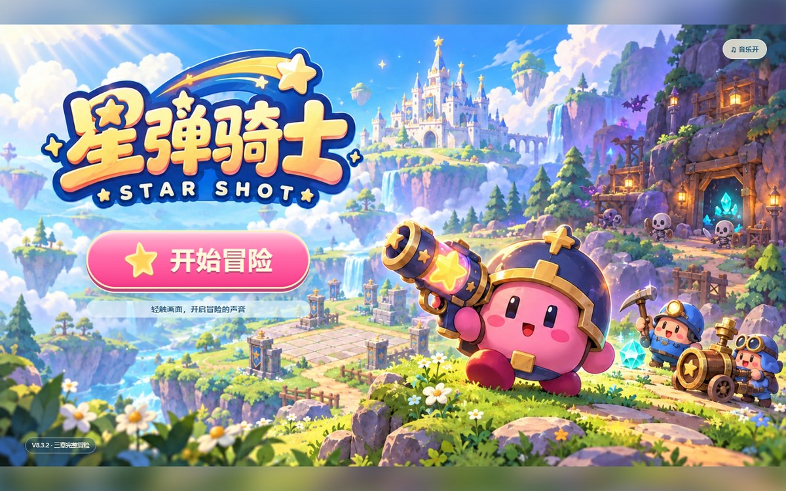
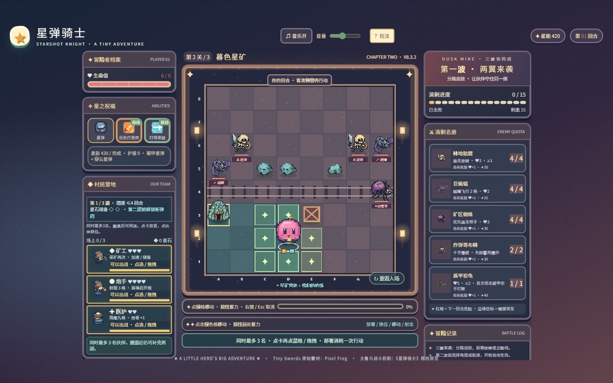
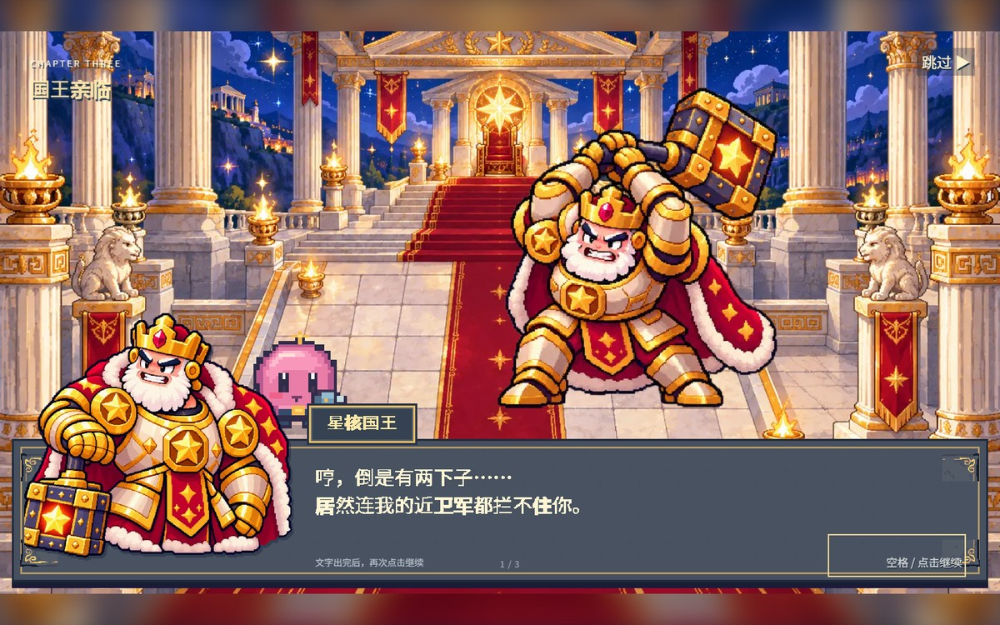
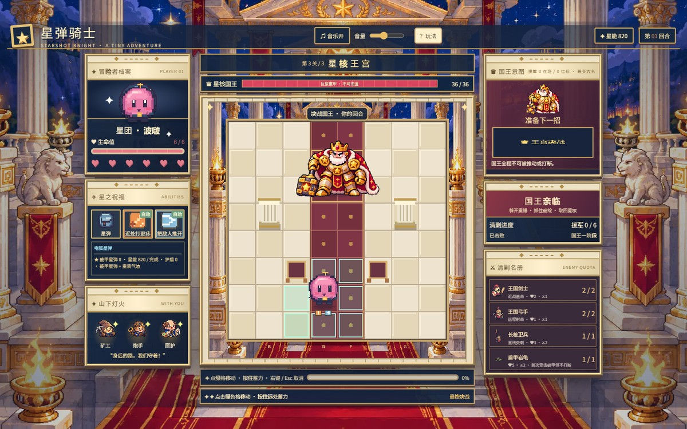

# 星弹骑士 StarShot Knights

一个像素风格的回合制战术小游戏：**蓄力射击 + 伙伴部署**，三关完整战役。

## ▶ [点这里直接玩](https://x-yunke.github.io/starshot-knights/)

不用下载、不用安装。电脑和手机都能玩。

> 📱 **手机玩家**：请用浏览器打开上面的网址（聊天软件里的文件预览跑不起完整游戏）。打开就是横版，把手机横过来看更舒服。

## 截图

**草原哨站 → 暮色星矿 → 星核王宫**，一路打到最后的大国王。

**第二关**：部署矿工、炮手、医护守住营地，扛三波来袭，中途选一种新弹药。

**第三关**：星核国王亲临王宫。

国王**真实占 2×2 四格**，一锤能砸裂地板；蓄力等待不会消耗破绽窗口，可以慢慢瞄准。

## 三关

| 关 | 名字 | 打什么 |
|---|---|---|
| 一 | **草原哨站** | 教学关。敌人直来直去，学会蓄力和躲红色预警 |
| 二 | **暮色星矿** | 部署村民守住营地，扛三波来袭，中途选一种新弹药 |
| 三 | **星核王宫** | 先打近卫，再打占 2×2 四格的星核国王；半血狂暴 |

## 怎么玩

| 操作 | 做法 |
|---|---|
| 移动 | 点绿色格子，走一格 |
| 射击 | 按住鼠标（或手指）蓄力，松手发射；右键 / Esc / 「取消瞄准」反悔，不耗行动 |
| 回血 | 击杀敌人时吸收星能 |
| 部署伙伴（第二关） | 点伙伴卡片再点蓝格，或直接把卡片拖过去（电脑在左栏，手机在右侧或底部） |
| 换位 | 点场上伙伴，再点两步内的蓝格（保留血量和进度） |
| 看面板 | 装备 / 敌军都点开看，打开不推进回合 |

第三关国王有三招：**王锤重击**、**星光震波**、半血之后的**碎地王锤**。
看到红色预警先躲；躲开重锤后，抓住「拔锤破绽」反击——平时也能造成伤害，但破绽窗口打得最快。

## 现在到哪一步

三关都有完整可玩闭环。第三关的**数值、动作节奏和演出还在精修**，所以你会看到它比前两关更"生"一些。

## 已知问题

- **第二关的村民还不够必需**：主角一个人也能清场，伙伴更像锦上添花。这条正在改。
- **手机没有真机验证**：iOS Safari、安卓 Chrome、微信内置浏览器都还没实测。如果你在手机上遇到问题，请告诉我**手机型号 + 浏览器 + 点了哪里**，这对改进帮助很大。
- 无尽模式、排行榜、游戏内致谢都还没做。

## 内测致谢

感谢参与内测、提过意见的每一位朋友——没有你们的反馈，就没有现在这一版。

## 素材

- 像素美术：[Pixel Frog](https://pixelfrog-assets.itch.io/) 的《Tiny Swords》系列（含付费 Enemy Pack，已购买授权）
- 字体：Noto Sans SC（SIL Open Font License）
- 角色「波啵」立绘与对话界面：本项目自制

《Tiny Swords》许可允许个人与商业使用、可修改、不强制署名，但禁止再分发素材包本身。所以本仓库只分发**游戏成品**，不提供原始素材文件。

## 版权

游戏内容保留所有权利。素材版权归原作者。
